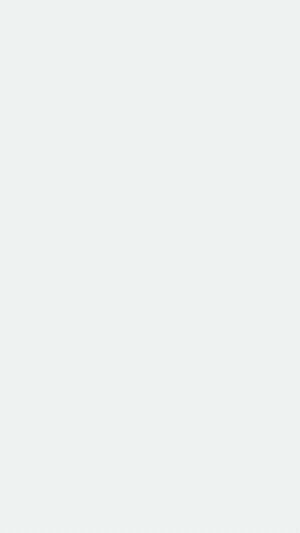
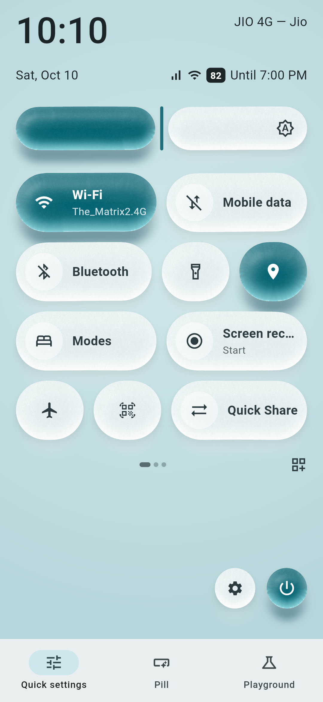
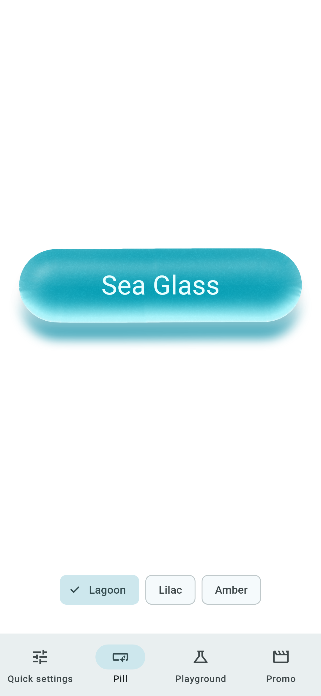
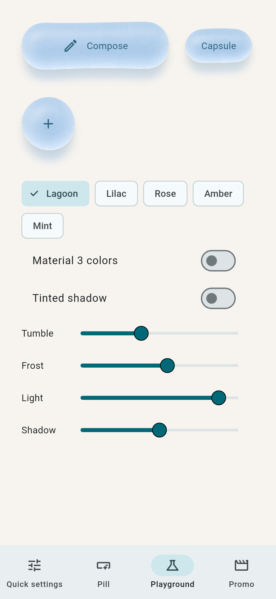
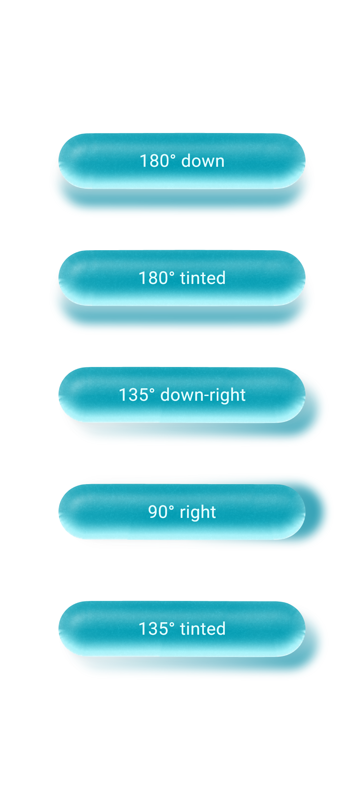

# sea_glass

Sea Glass gives Flutter widgets the look of frosted, sea-tumbled glass. It is a port of the
**Sea Glass** material concept ([mttmcknn/sea-glass](https://github.com/mttmcknn/sea-glass),
written in Compose) for Material 3 apps.

Each piece gets a seeded outline, a fine frost, a soft curve through the body, a bright lower edge
and coloured light spilling onto the surface below. Text and icons are ordinary widgets; the glass
is painted behind them.

<p align="center"></p>

<p align="center">
  
  
  
</p>

You need Flutter 3.41 or newer. That is the first release where Impeller accepts float32 textures.

```dart
SeaGlassButton(
  onPressed: compose,
  palette: SeaGlassPalette.lagoon,
  style: SeaGlassStyle.reference.copyWith(seed: 33),
  child: const Text('Compose'),
)
```

## Widgets

- `SeaGlassButton` is a real button: semantics, a 48 px minimum target, a focus ring, a disabled
  state and a 2 px press offset.
- `SeaGlassSurface` is a non-interactive container. It clips content to the outline and sets the
  ink colour.
- `SeaGlass` draws the material behind any child. Set `clipChild` if you need clipping.
- `SeaGlassTheme` supplies defaults for `style`, `palette` and `shape`. Nested themes only
  override what they set.
- `SeaGlassComponentStyle` bundles those three so a design system can pass them around.

## Shadow direction and tint

These are two additions to the original. Both only touch the ground light, which is the three
blurred layers in `RealtimeGround`. The glass body itself is unchanged.

- `shadowDegrees` controls where the cast shadow, contact shadow and transmitted colour pool go.
  180 is straight down, the default and the only direction in the original. 90 is right and 0 is
  up. It works separately from `lightDegrees`, which moves the surface reflections.
- `shadowTinted: true` uses the body pigment at 40% brightness for the cast and contact shadows,
  instead of the original's neutral gray.

```dart
SeaGlassStyle.reference.copyWith(shadowDegrees: 135, shadowTinted: true)
```

With the defaults (180 and untinted) the output matches the original. Every variant is checked
against the Kotlin exporter (`renderGroundExtended`), which applies the same change to the
original ground code path.

<p align="center"></p>

## Recipes and palettes

Use `SeaGlassStyle.reference`, `tumbled` or `quiet`, or build your own with
`copyWith(frost, grain, tumble, thickness, bulge, elevation, lightDegrees, transmission, seed)`.
The palettes are `lagoon`, `lilac`, `rose`, `amber` and `mint`. Shapes are `rounded`, `capsule`
and `disc`.

Keep a piece's `seed` stable. Give neighbours different seeds so their outlines do not repeat.

## Material 3 and dynamic colour

```dart
SeaGlassMaterialTheme(child: ...)                    // ambient ColorScheme, primary container
SeaGlassPalette.of(context, SeaGlassColorRole.tertiary)
SeaGlassPalette.fromColorScheme(dynamicScheme)       // e.g. from dynamic_color
```

## Fidelity to the original

`test/kotlin_parity_test.dart` checks this package against the original implementation.
`tool/kotlin_reference/export.sh` compiles the original Kotlin geometry sources without changes,
renders the original `SeaGlassBodyShader` through Skia (skiko 0.9.37.4, the version shipped with
Compose 1.10.3) and writes reference data. The pinned commit lives in
`test/fixtures/kotlin/REVISION`.

The comparison covers five cases: rounded, disc, capsule, portrait and a piece larger than the
sample budget.

| Stage | Result |
| --- | --- |
| Random stream, contour points | identical (also against the web reference) |
| Contour mask rasterization | identical bytes |
| Geometry textures (profiles, gradients, scales) | bit-identical floats |
| Body shader, Kotlin textures | pixel-identical RGBA |
| Body shader, full Dart pipeline | pixel-identical RGBA |
| Ground light (shadows, transmitted light) | max 3/255 per channel, mean below 1/255 |

The ground light differs slightly, and not because of the recipe. With blur turned off the alpha
matches, but premultiplied colour still differs by a few levels: the two Skia builds round
translucent blending differently. The original also uses each platform's own blur.

`shaders/sea_glass.frag` is a straight translation of `SeaGlassBodyShader.kt`. The type names, the
entry point and texture sampling differ, plus one extra `geometrySize` uniform. Textures are
rounded to binary16 before upload, which matches the original's RGBA_F16 uploads.

### First frame

Flutter cannot read back a rasterized mask or create an image synchronously, so a piece's first
geometry is built asynchronously. Ground and body appear together, so you never see half a piece.
If it has to be there on the very first frame, precache the size:

```dart
await SeaGlass.precache(const Size(270, 88), style: SeaGlassStyle.reference.copyWith(seed: 33));
```

Geometry lives in a shared LRU (32 entries, same as the original), so screens you revisit and
pieces that repeat also draw straight away.

### Not verified yet

- Rendering on a device or emulator. Impeller is the default on iOS and Android and may round
  differently from the Skia software renderer that `flutter test` uses.

### One layout caveat

The material paints up to 48 px outside its layout box, so keep clipping ancestors out of the way.

## Example

`example/` has four tabs:

- **Quick settings**: an Android-style panel with toggle tiles and a glass brightness slider.
- **Pill**: one large glass pill.
- **Playground**: recipes, palettes, Material 3 colours and live sliders.
- **Promo**: an 8 second vertical loop.

`example/tool/render_promo.sh` renders the promo frame by frame with the real shader and uses
ffmpeg to build `doc/promo/sea_glass_promo.mp4` (720 x 1280, 30 fps). Pass `button`, `screen` or
`tumble` to render one of the shorter clips.

`example/test/screenshot_test.dart` renders each page with the real shader and regenerates
`doc/screenshots/`.

## License

Apache 2.0. See [LICENSE](LICENSE) and [NOTICE](NOTICE). The material design and shader math come
from [mttmcknn/sea-glass](https://github.com/mttmcknn/sea-glass), also Apache 2.0. This package is
a port with the changes listed in NOTICE.
