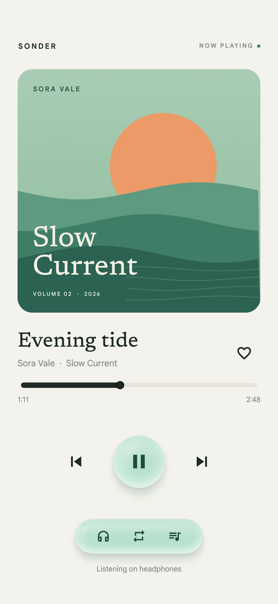
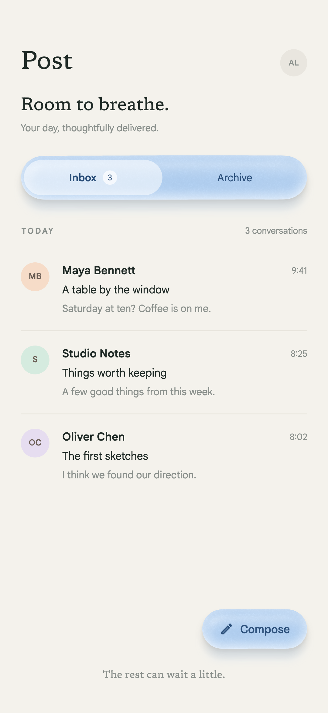
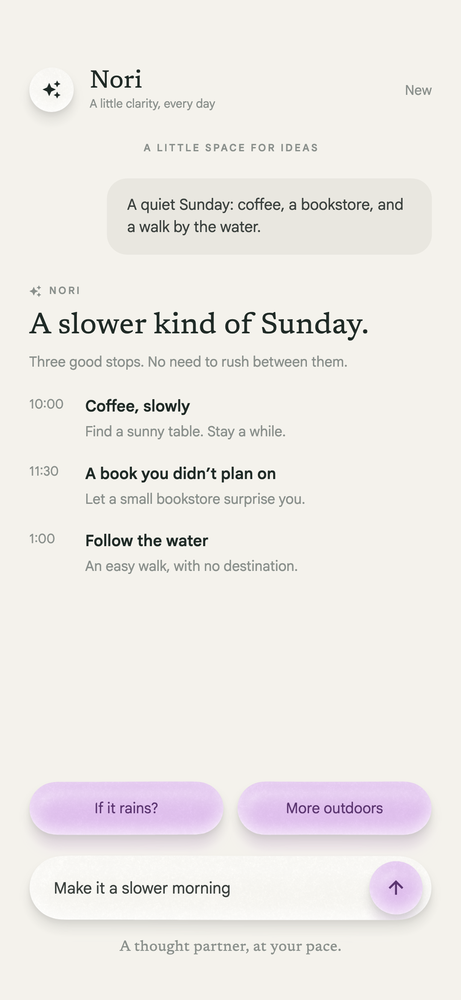
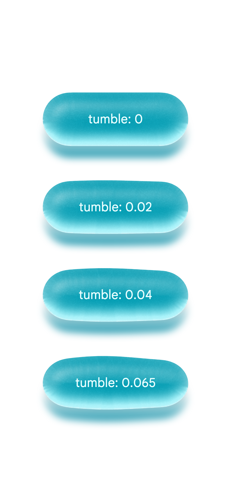

# sea_glass

Frosted, softly tumbled sea glass for Flutter widgets, drawn with a real shader.

It brings the **Material 4 Sea Glass** concept to Flutter: a fan-made idea of sea glass as the next
Material Design material, first proposed by [@SLKVinyl](https://x.com/SLKVinyl). It is not an
official Google design. The rendering is a port of
[mttmcknn/sea-glass](https://github.com/mttmcknn/sea-glass) (Compose).

<p align="center">
  
  
  
</p>

## Get started

```bash
flutter pub add sea_glass
```

You need Flutter 3.41 or newer. That is the first release where Impeller accepts float32 textures.

```dart
SeaGlassButton(
  onPressed: play,
  shape: SeaGlassShape.disc,
  palette: SeaGlassPalette.mint,
  style: SeaGlassStyle.quiet,
  child: const Icon(Icons.play_arrow),
)
```

Each piece gets a seeded outline, a fine frost, a soft curve through the body, a bright lower edge
and coloured light spilling onto the surface below. Text and icons are ordinary widgets; the glass
is painted behind them.

## Widgets

- `SeaGlassButton` is a real button: semantics, a 48 px minimum target, a focus ring, a disabled
  state and a 2 px press offset.
- `SeaGlassSurface` is a non-interactive container. It clips content to the outline and sets the
  ink colour.
- `SeaGlass` draws the material behind any child. Set `clipChild` if you need clipping.
- `SeaGlassTheme` supplies defaults for `style`, `palette` and `shape`. Nested themes only
  override what they set.
- `SeaGlassComponentStyle` bundles those three so a design system can pass them around.

## Make it yours

Use `SeaGlassStyle.reference`, `tumbled` or `quiet`, or build your own with
`copyWith(frost, grain, tumble, thickness, bulge, elevation, lightDegrees, transmission, seed)`.
The palettes are `lagoon`, `lilac`, `rose`, `amber` and `mint`. Shapes are `rounded`, `capsule`,
`disc` and `squircle`.

For calm interfaces like the screens above, keep `transmission` and `elevation` low: the glass
reads as frosted rather than glowing.

`tumble` sets how far the outline wanders from a clean shape, like glass worn by the sea: 0 is a
perfect shape and 0.065 is the most worn. `seed` picks which outline you get, so keep it fixed for a
piece that should not change between rebuilds, and give neighbours different seeds so their
outlines do not repeat.

<p align="center"></p>

## Shadows

These are additions to the original. They only touch the ground light, which is the three blurred
layers in `RealtimeGround`. The glass body itself is unchanged.

- `shadowDegrees` controls where the cast shadow, contact shadow and transmitted colour pool go.
  180 is straight down, the default and the only direction in the original. 90 is right and 0 is
  up. It works separately from `lightDegrees`, which moves the surface reflections.
- `shadowTinted: true` uses the body pigment at 40% brightness for the cast and contact shadows,
  instead of the original's neutral gray.
- `shadowColor` sets the shadow colour, and its alpha scales the opacity. Use
  `Colors.black.withValues(alpha: .5)` for lighter shadows, or `Colors.transparent` for none (useful
  on photos). The transmitted colour pool is set separately by `transmission`.

```dart
SeaGlassStyle.quiet.copyWith(shadowDegrees: 135, shadowTinted: true)
SeaGlassStyle.quiet.copyWith(shadowColor: Colors.transparent, transmission: 0) // no ground light
```

With the defaults (180 and untinted) the output matches the original. Every variant is checked
against the Kotlin exporter (`renderGroundExtended`), which applies the same change to the
original ground code path.

<p align="center"></p>

## Material 3 and dynamic colour

```dart
SeaGlassMaterialTheme(child: ...)                    // ambient ColorScheme, primary container
SeaGlassPalette.of(context, SeaGlassColorRole.tertiary)
SeaGlassPalette.fromColorScheme(dynamicScheme)       // e.g. from dynamic_color
```

## Fidelity to the original

`test/kotlin_parity_test.dart` checks this package against the original implementation.
The fixtures were generated by compiling the original Kotlin geometry sources without changes and
rendering the original `SeaGlassBodyShader` through Skia (skiko 0.9.37.4, the version shipped with
Compose 1.10.3). The harness that produces them lives in `tool/kotlin_reference`. The pinned commit
lives in `test/fixtures/kotlin/REVISION`.

The comparison covers five cases: rounded, disc, capsule, portrait and a piece larger than the
sample budget.

| Stage | Result |
| --- | --- |
| Random stream, contour points | identical (also against the web reference) |
| Contour mask rasterization | identical bytes |
| Geometry textures (profiles, gradients, scales) | bit-identical floats |
| Body shader, Kotlin textures | pixel-identical RGBA |
| Body shader, full Dart pipeline | pixel-identical RGBA |
| Ground light (shadows, transmitted light) | max 3/255 per channel, mean below 1/255 |

The ground light differs slightly, and not because of the recipe. With blur turned off the alpha
matches, but premultiplied colour still differs by a few levels: the two Skia builds round
translucent blending differently. The original also uses each platform's own blur.

`shaders/sea_glass.frag` is a straight translation of `SeaGlassBodyShader.kt`. The type names, the
entry point and texture sampling differ, plus one extra `geometrySize` uniform. Textures are
rounded to binary16 before upload, which matches the original's RGBA_F16 uploads.

### First frame

Flutter cannot read back a rasterized mask or create an image synchronously, so a piece's first
geometry is built asynchronously. Ground and body appear together, so you never see half a piece.
If it has to be there on the very first frame, precache the size:

```dart
await SeaGlass.precache(const Size(270, 88), style: SeaGlassStyle.reference.copyWith(seed: 33));
```

Geometry lives in a shared LRU (32 entries, same as the original), so screens you revisit and
pieces that repeat also draw straight away.

### One layout caveat

The material paints up to 48 px outside its layout box, so keep clipping ancestors out of the way.

## License

Apache 2.0. See [LICENSE](LICENSE).
